# VLSI-Physical-Verification-Sky130A

A hands-on VLSI physical verification project using the SKY130A PDK. Covers CMOS inverter schematic design, layout creation in Magic, Design Rule Checking (DRC), Layout Versus Schematic (LVS), SPICE netlist extraction, and post-layout transient simulation using ngspice. Documents the workflow, results, and key learnings.

## 0. Theory — SKY130A PDK and Open-Source EDA Flow

### 0.1 SKY130A Process Design Kit (PDK)

The SKY130A PDK is an open-source 130 nm CMOS process design kit. It provides technology files, device models, libraries, and design rules required for integrated circuit design and verification.

The PDK supports CMOS device implementation and provides information used by EDA tools for schematic design, circuit simulation, physical layout, and verification.


### 0.2 Libraries

**PDK Models and Libraries**

The SKY130A PDK provides different resources for different stages of the design flow:

- **SPICE device models:** Describe the electrical behaviour of transistors and are used by NGSpice to simulate circuit operation.
- **Technology files:** Define physical layers, layer properties, and design rules used by Magic VLSI for layout creation and DRC.
- **Device and cell libraries:** Provide technology-specific device definitions and, where applicable, standard-cell information for supported design flows.
- **LVS setup files:** Define device recognition and comparison rules used by Netgen to compare the schematic netlist with the extracted layout netlist.

In this project, the SKY130A NFET and PFET devices are used to build the CMOS inverter. Xschem generates the schematic-level SPICE netlist, NGSpice simulates the circuit, Magic VLSI creates and checks the physical layout, and Netgen verifies layout-to-schematic connectivity.


### 0.3 SKY130A Physical Layers

The physical layout is built using technology-defined layers representing semiconductor regions, transistor gates, contacts, and metal interconnections.

**Screenshot 0: SKY130A Physical Layer Stack**

The diagram below shows a cross-section of the SKY130A process stack, including device regions, local interconnect, contacts, metal layers, and vias.

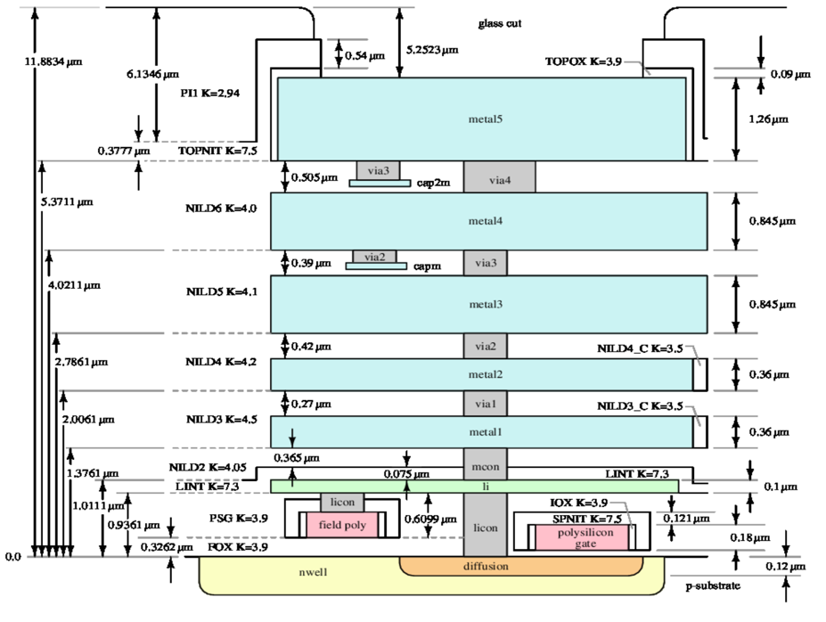

The main structures shown in the diagram are:

- **Substrate and well:** The p-substrate and N-well form the underlying semiconductor regions.
- **Diffusion and polysilicon:** Used to form transistor active regions and gates.
- **Local interconnect (LI):** Provides local electrical connections between device regions and upper interconnect.
- **Contacts:** Licon and mcon connect device-level structures to local interconnect and Metal1.
- **Metal1 to Metal5:** Five metal interconnect layers used to route electrical signals and power.
- **Vias:** Via1, Via2, Via3, and Via4 connect successive metal layers.
- **Dielectric layers:** Insulating materials between conductive levels electrically separate the interconnect layers.

### 0.4 Open-Source EDA Flow

This project uses an open-source EDA flow to design and verify a CMOS inverter.

1. **Xschem — Schematic design:** Create the CMOS inverter schematic and generate its SPICE netlist.
2. **NGSpice — Pre-layout simulation:** Simulate the schematic to verify the inverter's input-output behavior.
3. **Magic VLSI — Physical layout:** Create and connect the transistor layout using SKY130A technology layers.
4. **DRC — Design Rule Check:** Check the physical layout against the PDK design rules.
5. **Extraction:** Extract the layout netlist and parasitic information from the physical layout.
6. **Netgen — LVS verification:** Compare the extracted layout netlist against the Xschem-generated reference netlist.
7. **NGSpice — Post-layout simulation:** Simulate the extracted circuit to evaluate its behavior with layout-related parasitic effects.

This flow connects schematic design, circuit simulation, physical layout, and verification to check that the implemented layout behaves as intended and matches the reference circuit.

---

## Tools Used

| Tool | Version | Purpose |
|---|---|---|
| Magic VLSI | 8.3 | Layout design and DRC |
| Xschem | 3.4.8RC | Schematic capture and netlist |
| Netgen | 1.5.325 | LVS comparison |
| NGSpice | 37 | Pre and post-layout simulation |
| SKY130A PDK | Latest | Process design kit |

---

## Development Environment

- **Host OS:** Windows 11
- **Virtualization:** Oracle VirtualBox
- **Guest OS:** Ubuntu 24.04.5 LTS

> **Note:** Ubuntu 26.04.1 LTS (latest) was initially attempted but caused tool compatibility issues during EDA tool compilation. Downgraded to Ubuntu 24.04.5 LTS for a stable environment.

### System Resources

| Resource | Value |
|---|---|
| OS | Ubuntu 24.04.5 LTS (Noble) |
| Kernel | 7.0.0-38-generic |
| RAM (total) | 10 GiB |
| RAM (available) | 2.9 GiB |
| Swap | 4.0 GiB |
| CPU cores | 4 |
| Disk size | 59 GiB |
| Disk used | 38 GiB (68%) |
| Disk available | 19 GiB |

## 1. Environment Setup

### 1.1 System Validation

```bash
lsb_release -a
uname -a
free -h
df -h /
nproc
```
**Screenshot 1: System Information and Environment Verification**

Shows the Ubuntu operating system details, kernel version, available memory, CPU cores, and disk usage used for the project.
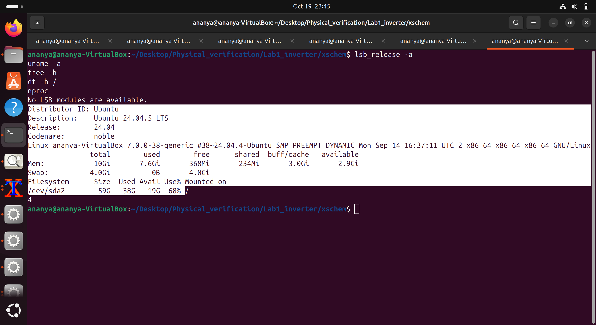

### 1.2 Package Update

```bash
sudo apt update && sudo apt upgrade -y
```

### 1.3 Git Installation and Repository Setup

```bash
sudo apt install git -y
git --version
```
**Screenshot 2: Git Version Verification**

Shows Git version verification for source code management and project documentation.

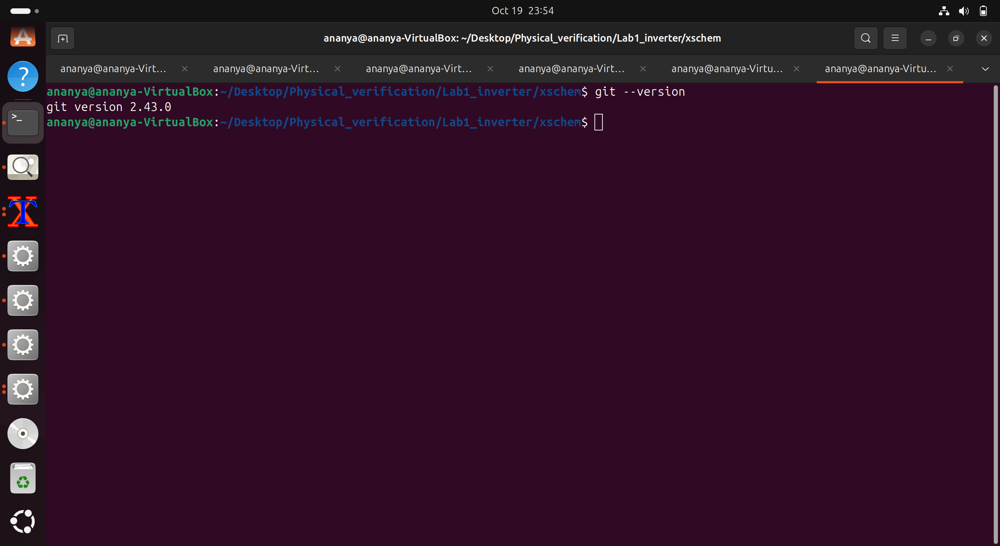

---

## 2. EDA Tool Installation and Verification

### 2.1 Magic VLSI

#### Installation

```bash
git clone git://opencircuitdesign.com/magic
cd magic
sudo apt install tcl-dev tk-dev -y
```

#### Problem 1 — GCC Compilation Error

```
error: too many arguments to function 'WindAddCommand'
error: too many arguments to function 'WindMove'
error: too many arguments to function 'WindSetWindowAreas'
```

**Cause:** Default C standard in GCC is incompatible with older Magic source code.

**Fix:**
```bash
make clean
./configure CFLAGS="-std=gnu17"
make
```

#### Verify Magic is Working

```bash
which magic          # /usr/local/bin/magic
magic --version
magic -d XR     # launch with SKY130A tech
```


**Screenshot 3: Magic VLSI Verification**

Shows the installed Magic VLSI tool and its version, confirming that the layout editor is available for physical design and DRC.

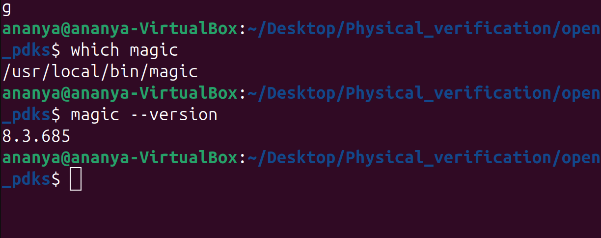

---

### 2.2 Xschem

#### Installation

```bash
git clone https://github.com/StefanSchippers/xschem.git xschem_git
./configure
make
sudo make install
```

#### Verify Xschem is Working

```bash
xschem --version
xschem
```


**Screenshot 4: Xschem Launch and Verification**

Shows Xschem running successfully, confirming that the schematic capture and SPICE netlisting environment is available.

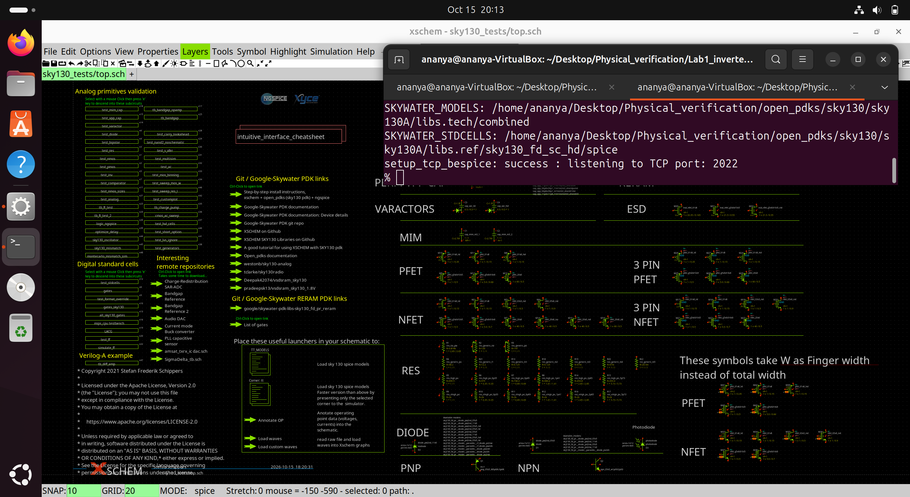

---

### 2.3 Netgen

#### Installation

```bash
git clone git://opencircuitdesign.com/netgen
cd netgen
./configure && make && sudo make install
```

#### Verify Netgen is Working

```bash
netgen --version
netgen
```


**Screenshot 5: Netgen Verification**

Shows Netgen launching successfully for Layout Versus Schematic (LVS) comparison.

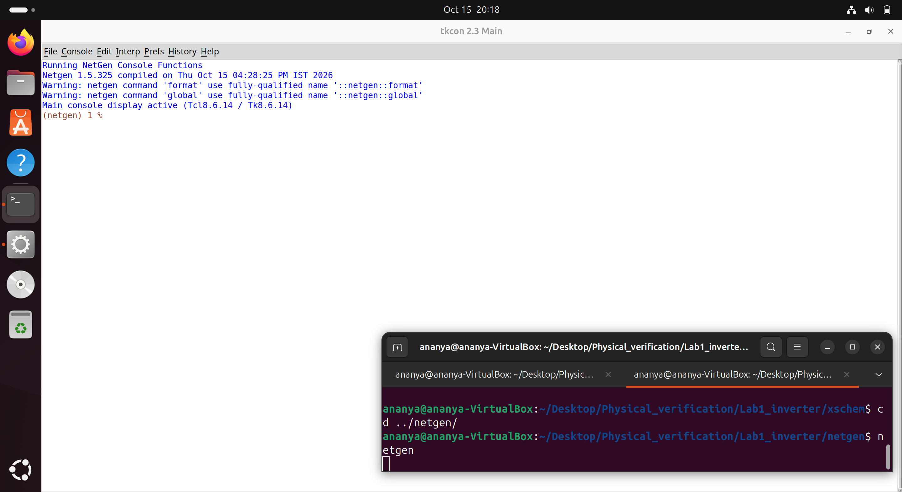

---

### 2.4 NGSpice

#### Installation

```bash
sudo apt install ngspice -y
```

#### Verify NGSpice is Working

```bash
ngspice --version
ngspice
```


**Screenshot 6: NGSpice Verification**

Shows NGSpice launching successfully for SPICE-based circuit simulation.

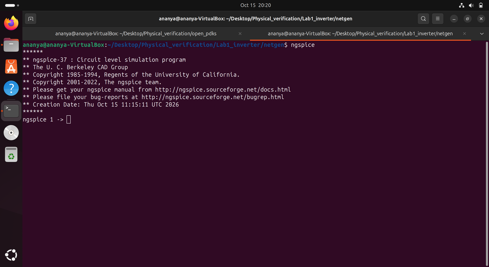

---

### 2.5 SKY130A PDK

#### Installation

```bash
git clone https://github.com/RTimothyEdwards/open_pdks.git
cd open_pdks
./configure --enable-sky130-pdk
make
sudo make install
```

#### Verify PDK Files

```bash
ls ~/Desktop/Physical_verification/open_pdks/sky130/sky130A/libs.tech/
ls ~/Desktop/Physical_verification/open_pdks/sky130/sky130A/libs.tech/magic/
ls ~/Desktop/Physical_verification/open_pdks/sky130/sky130A/libs.tech/netgen/
ls ~/Desktop/Physical_verification/open_pdks/sky130/sky130A/libs.tech/ngspice/
```


**Screenshot 7: SKY130A PDK Verification**

Shows the SKY130A PDK technology files and supporting libraries used by Magic, Netgen, and NGSpice.

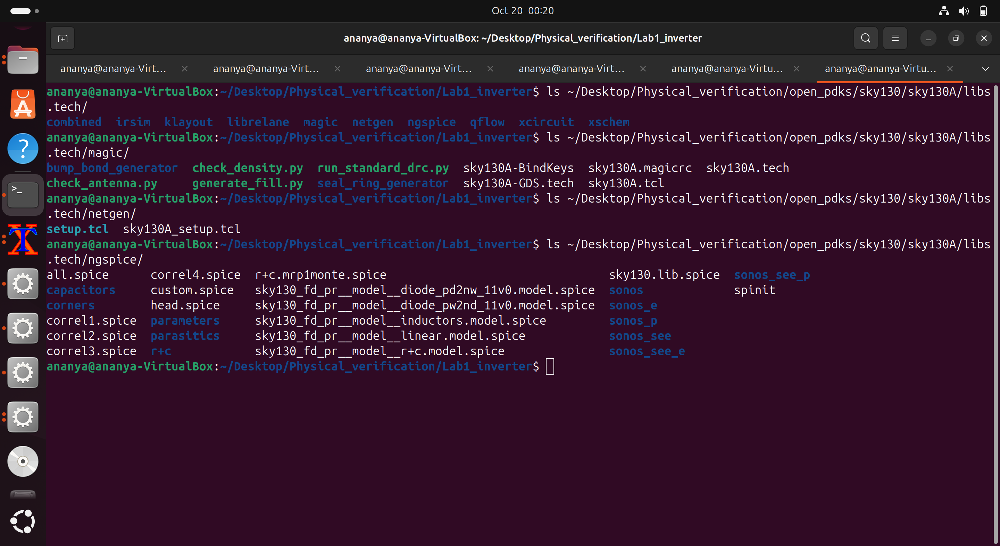

#### Integration Check — Magic with SKY130A

```bash
magic -T ~/Desktop/Physical_verification/open_pdks/sky130/sky130A/libs.tech/magic/sky130A.tech
```

Inside Magic console:
```tcl
tech name     # should print: sky130A
```
**Screenshot 8: SKY130A Technology Integration with Magic**

Shows Magic launched with the SKY130A technology file, confirming that the process technology is loaded for layout design and design rule checking.

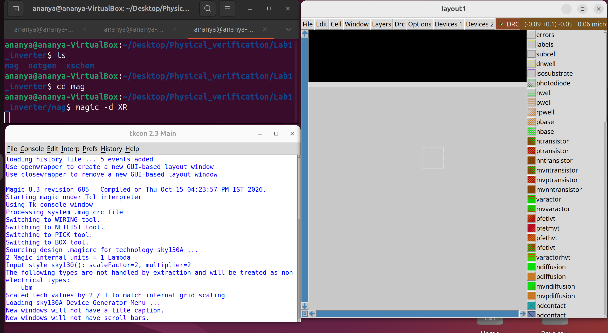

---

### 2.6 Device Layout — SKY130A Transistor Layer Inspection

To understand how MOS transistors are represented in physical layout, the SKY130A NFET and PFET device cells were loaded and inspected in Magic VLSI with the SKY130A technology.

The device layouts contain multiple technology layers that define the transistor structure and its electrical connections.

- **NFET:** The layout shows the NMOS device structure, including diffusion, polysilicon, contacts, and metal interconnects.
- **PFET:** The layout shows the PMOS device structure and its corresponding physical layers. The surrounding well and substrate-related regions are also visible.

Inspecting these layers helps explain how transistor terminals and gate structures are represented physically before integrating devices into a complete CMOS circuit.

**Screenshot : SKY130A NFET Device Layout**

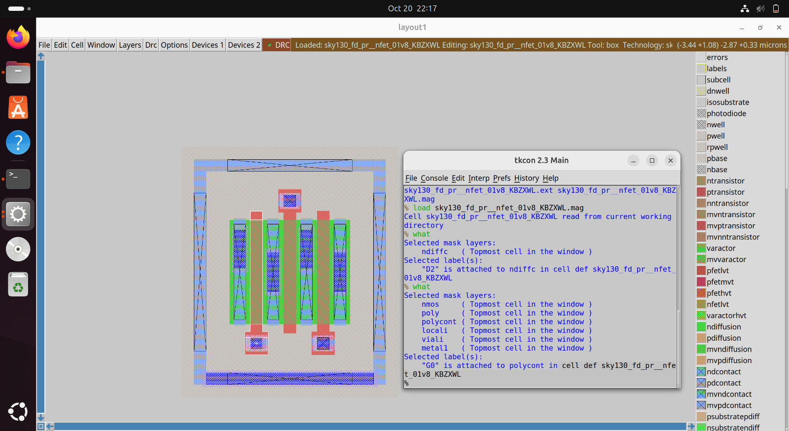

Shows the SKY130A NFET device cell loaded in Magic VLSI, with its physical layers displayed.

**Screenshot : SKY130A PFET Device Layout**

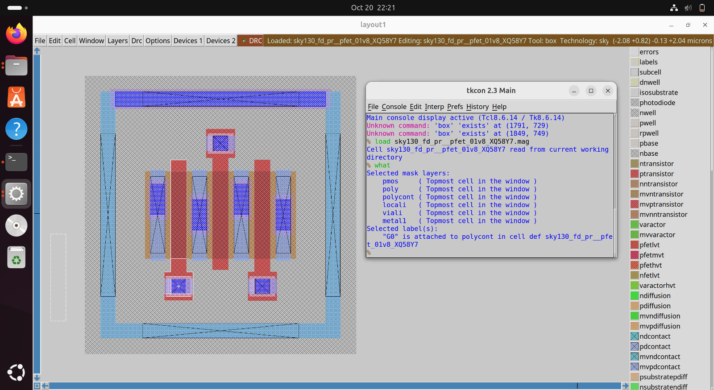

Shows the SKY130A PFET device cell loaded in Magic VLSI, with its physical layers and surrounding regions displayed.

## 3. Lab 1 — CMOS Inverter Physical Verification

### Inverter Specifications

| Parameter | NFET (M1) | PFET (M2) |
|---|---|---|
| Model | sky130_fd_pr__nfet_01v8 | sky130_fd_pr__pfet_01v8 |
| Width (W) | 4.5 µm | 3 µm |
| Length (L) | 0.18 µm | 0.18 µm |
| Fingers (nf) | 3 | 3 |
| Body | VSS | VDD |

---

### 3.1 Schematic — Xschem

The CMOS inverter schematic is created in Xschem using the SKY130A NFET and PFET devices. 

```bash
cd Lab1_inverter/xschem
xschem inverter_1.sch
```
**Screenshot 9: CMOS Inverter Schematic in Xschem**

Shows the CMOS inverter schematic containing the SKY130A NFET and PFET devices, with the input, output, VDD, and VSS connections.

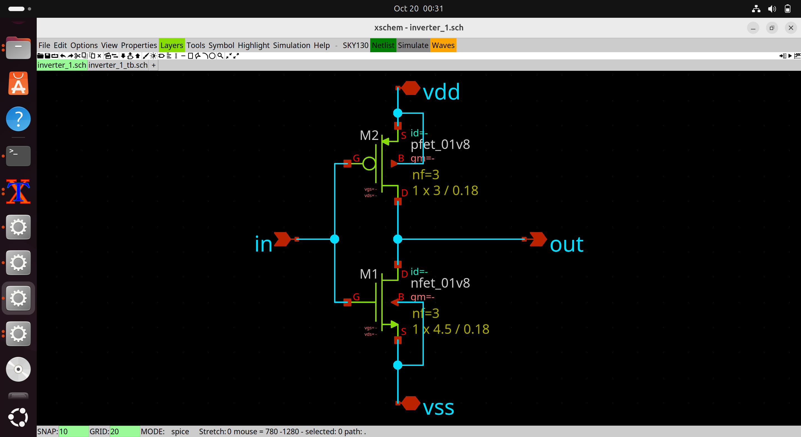

#### Symbol Creation

After creating the inverter schematic, a symbol is created for the `inverter_1` subcircuit, and its pins were configured for VDD, input, output, and VSS.

**Screenshot 10: Custom CMOS Inverter Symbol**

Shows the custom symbol created for the inverter subcircuit, with pins configured for VDD, input, output, and VSS.

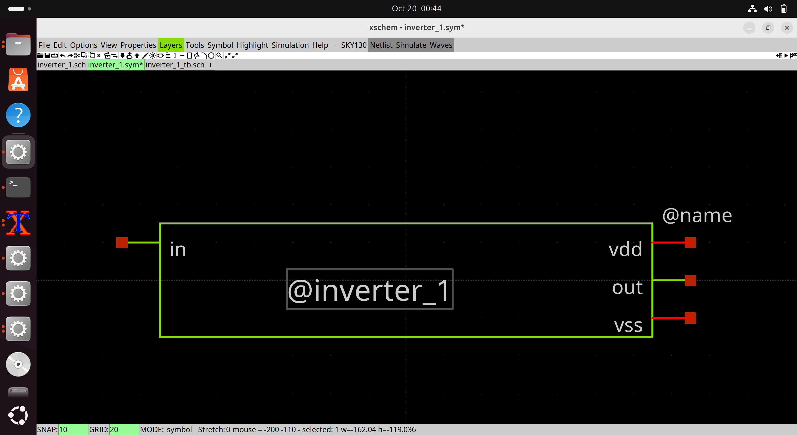

The schematic is netlisted in Xschem, and the generated SPICE netlist is saved.

**Netlist generated:**

```spice
.subckt inverter_1 vdd in out vss
XM1 out in vss vss sky130_fd_pr__nfet_01v8 L=0.18 W=4.5 nf=3
XM2 out in vdd vdd sky130_fd_pr__pfet_01v8 L=0.18 W=3 nf=3
.ends
```

### 3.2 Schematic Testbench — Pre-Layout Simulation

Before drawing the layout, the schematic is simulated to confirm correct inverter behavior using NGSpice.

#### Testbench Circuit — `xschem/inverter_1_tb.sch`

The testbench was drawn in Xschem with:
- `V1 = 1.8V` DC supply
- `V2` = PULSE input
- `inverter_1` subcircuit instantiated

**Screenshot 11: Pre-Layout Simulation Testbench**

Shows the Xschem testbench used to simulate the CMOS inverter before layout, including the supply voltage, input pulse source, and inverter instance.

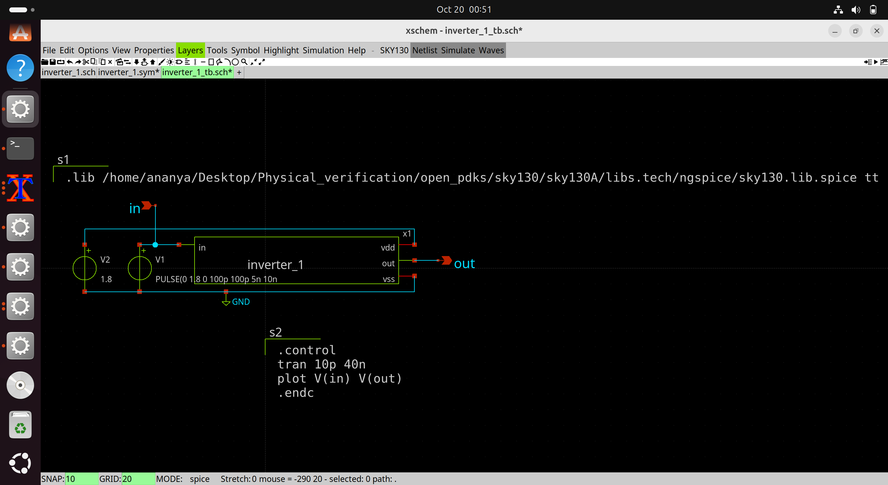

**Screenshot 12: Pre-Layout Transient Simulation**

Shows the NGSpice transient simulation waveforms before layout, demonstrating the complementary relationship between the inverter input and output.

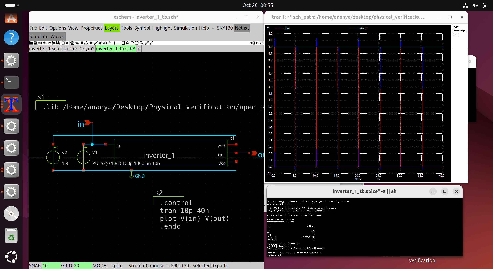

---

### 3.3 Layout — Magic VLSI

```bash
cd Lab1_inverter/mag
magic 
```

#### Import the SPICE Netlist

The physical layout is drawn and connected in Magic using SKY130A layers and design rules. `readspice` reads a SPICE netlist; it does not automatically generate a routed physical layout.

Inside the Magic console, read the schematic SPICE netlist when needed:

```tcl
readspice ../xschem/inverter_1.spice

```

Layout details:
- NFET placed with VSS rail at the bottom
- PFET placed with VDD rail at the top
- 3-finger layout for both devices
- Metal2 jumper used

**Screenshot 13: CMOS Inverter Layout in Magic VLSI**

Shows the physical layout of the CMOS inverter using SKY130A layers, including the NFET, PFET, metal interconnects, and supply connections.

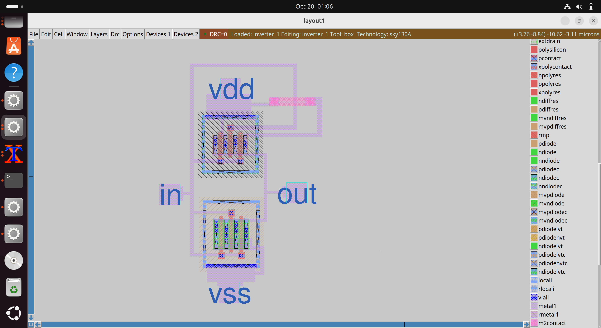

---

### 3.3 DRC — Design Rule Check

Inside the Magic console:

```tcl
drc check
drc count
drc why
```

**Result:**
```
DRC errors: 0 
```

**Screenshot 14: Design Rule Check (DRC) Verification**

Shows the final Magic DRC verification result. The documented final result is zero DRC errors.

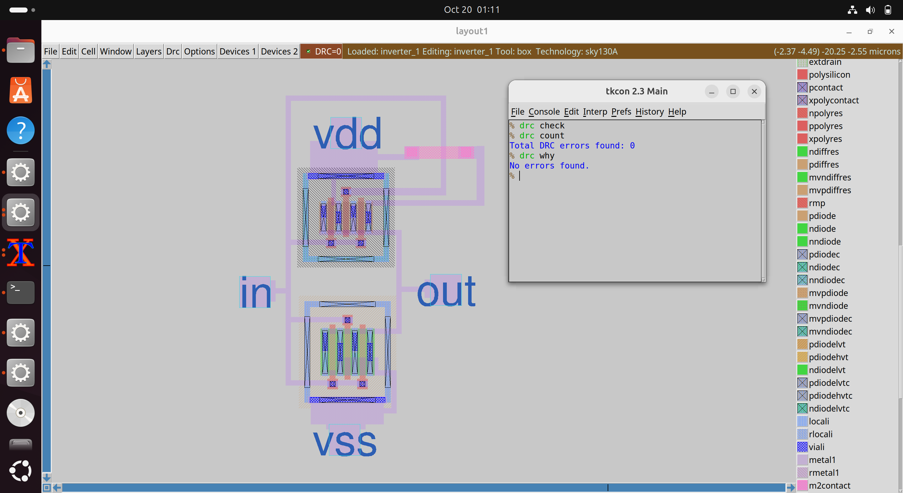

---

### 3.4 Extraction from Magic

Inside the Magic console:

```tcl
extract all
ext2spice lvs
ext2spice
```

---

### 3.5 LVS — Layout vs Schematic

LVS is performed using Netgen to verify that the physical layout matches the original circuit schematic. For this comparison, the **SPICE netlist generated from Xschem** is compared with the **SPICE netlist extracted from the Magic layout** to check whether the devices and electrical connections match.

```bash
cd Lab1_inverter/netgen
netgen -batch lvs \
  "../mag/inverter_1.spice inverter_1" \
  "../xschem/inverter_1.spice inverter_1" \
  /usr/share/pdk/sky130A/libs.tech/netgen/sky130A_setup.tcl \
  /tmp/inverter_1_lvs.log
```

**Final result:**

```
sky130_fd_pr__nfet_01v8 (3->1)  |  sky130_fd_pr__nfet_01v8 (1)  
sky130_fd_pr__pfet_01v8 (3->1)  |  sky130_fd_pr__pfet_01v8 (1)  
Number of devices: 2            |  Number of devices: 2          
Number of nets:    4            |  Number of nets:    4          

Final result: Circuits match uniquely. 
```

**Screenshot 15: Layout Versus Schematic (LVS) Verification**

Shows the Netgen LVS comparison between the extracted layout netlist and the reference schematic netlist, with the final result indicating that the circuits match uniquely.

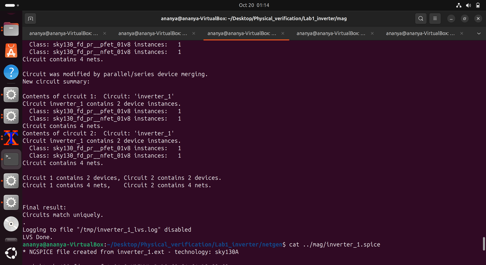

---

### 3.6 LVS Debugging — Problems and Fixes

#### Problem 1 — Floating NFET source nodes (XM1/S1, XM1/S2)

**Error:**
```
Net: XM1/S1  →  (no matching net)
Net: XM1/S2  →  (no matching net)
Nets: 8 (layout) vs 4 (schematic)
```

**Root cause:**
A 3-finger NFET has 4 diffusion strips alternating Drain-Source-Drain-Source. The 2 inner source strips (S1, S2) were not connected to VSS, so Magic extracted them as separate floating nets instead of merging the 3 transistors into one.

**Fix:**
Added Metal1 contacts on both inner source strips of NFET and connected them to the VSS rail.

**Result:** NFET 3 separate devices → 1 merged device 

---

#### Problem 2 — Floating PFET source nodes (XM2/S1, XM2/S2)

**Same issue** — PFET inner source strips not connected to VDD.

**Extra challenge:**
S1 routing upward to VDD was blocked by D2 (drain connected to `out`). Routing Metal1 directly caused a short between `out` and `vdd`.

**Fix:**
Used a roundabout from the in pin [Metal1 → Via1 → Metal2 → Via1 → Metal1] jumper to route over D2 without shorting.

**Result:** PFET 3 devices → 1 merged device 

---


#### LVS Progression Summary

| Attempt | NFET | PFET | Nets L/S | Devices L/S | Status |
|---|---|---|---|---|---|
| Initial | 3→2 | 3→2 | 8 vs 4 | 4 vs 2 | Wrong |
| Fix NFET S1,S2 | 3→1 | 3→2 | 5 vs 4 | 3 vs 2 | Wrong |
| Fix PFET S2 only | 3→1 | 3→2 | 5 vs 4 | 3 vs 2 | Wrong |
| Fix drain + S1 via jumper | 3→1 | 3→1 | 4 vs 4 | 2 vs 2 | Correct |

---

### 3.7 Post-Layout Simulation — NGSpice

After LVS sign-off, the Magic-extracted SPICE netlist (which includes parasitic capacitances from the actual layout) is simulated using the testbench below.

```spice
.lib "/home/ananya/Desktop/Physical_verification/open_pdks/sky130/sky130A/libs.tech/ngspice/sky130.lib.spice" tt

.include "inverter_1.spice"

VDD vdd 0 DC 1.8
VIN in 0 PULSE(0 1.8 0 100p 100p 5n 10n)

XINV vdd in out 0 inverter_1
CLOAD out 0 10f

.control
tran 10p 40n
plot V(in) V(out)
.endc
.end
```

#### Run

```bash

ngspice postlayout_tb.spice
```

**No. of Data Rows: 4053**

**Observation:**
- `in` HIGH → `out` LOW 
- `in` LOW → `out` HIGH 

#### Pre-Layout vs Post-Layout Comparison

| Parameter | Schematic Sim | Post-Layout Sim |
|---|---|---|
| Logic function | Correct inverter  | Correct inverter  |
| VDD | 1.8V | 1.8V |
| Input swing | 0 → 1.8V | 0 → 1.8V |
| Output swing | 1.8V → 0V | 1.8V → 0V |
| Parasitics | None (ideal) | Included (RC extracted) |


**Screenshot 16: Pre-Layout vs. Post-Layout Simulation**

The left waveform shows the pre-layout simulation, while the right shows the post-layout simulation. In both, `V(out)` (blue) is the logical complement of `V(in)` (red), confirming correct CMOS inverter operation.

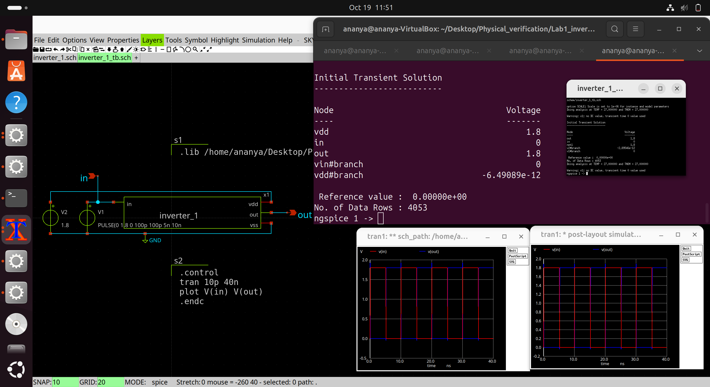

---

## 4. Observations

1. **Pre-layout simulation:** The schematic testbench showed complementary input and output waveforms, confirming the intended CMOS inverter logic before layout.
  
2. **DRC:** The final Magic layout was checked with `drc check` and `drc count`. The documented final result was **0 DRC errors**.
  
3. **LVS:** The final LVS run showed the circuits matched uniquely.

4. **Post-layout simulation:** The extracted layout netlist was simulated with NGSpice. The output remained complementary to the input. The post-layout netlist includes layout-extracted parasitics, unlike the ideal schematic-level simulation.

  
## 5. Key Learnings

1. **Multi-finger FET connections:** Every diffusion strip must be explicitly wired. Magic extracts each floating strip as a separate net, breaking LVS.

2. **Metal2 jumper routing:** When Metal1 routing is blocked, Metal1→Via1→Metal2→Via1→Metal1 is the standard solution to cross over conflicting nets.

3. **LVS is diagnostic:** Net fanout counts in the LVS report precisely identify which connection is wrong, making debugging systematic.

4. **OS compatibility:** Ubuntu 26.04.1 caused build failures. Ubuntu 24.04.1 LTS provided a stable environment for all EDA tools.

---

## 6. Repository Structure

```

VLSI-Physical-Verification-Sky130A/
├── README.md
├── Lab1_inverter/
│   ├── mag/
│   │   ├── inverter_1.ext
│   │   ├── inverter_1.mag
│   │   ├── inverter_1.spice
│   │   ├── sky130_fd_pr__nfet_01v8_KBZXWL.ext
│   │   ├── sky130_fd_pr__nfet_01v8_KBZXWL.mag
│   │   ├── sky130_fd_pr__pfet_01v8_XQ58Y7.ext
│   │   └── sky130_fd_pr__pfet_01v8_XQ58Y7.mag
│   ├── netgen/
│   │   ├── inverter_1_lvs.log
│   │   └── sky130A_setup.tcl
│   ├── ngspice/
│   │   ├── postlayout_tb.spice
│   │   └── postlayout_waveform.raw
│   └── xschem/
│       ├── inverter_1.sch
│       ├── inverter_1.spice
│       ├── inverter_1.sym
│       ├── inverter_1_tb.sch
│       ├── inverter_1_tb.spice
│       ├── inverter_tb.sch
│       ├── prelayout_waveform.raw
│       └── xschemrc
└── screenshots/
    ├── 00_sky130_layers.png
    ├── 01_system_info.png
    ├── 02_git_setup.png
    ├── 03_magic_version.png
    ├── 04_xschem_launch.png
    ├── 05_netgen_launch.png
    ├── 06_ngspice_launch.png
    ├── 07_pdk_verify.png
    ├── 08_magic_sky130.png
    ├── 09a_schematic.png
    ├── 09b_symbol.png
    ├── 10_tb_schematic.png
    ├── 11_prelayout_simulation.png
    ├── 12_layout.png
    ├── 13_drc_clean.png
    ├── 14_lvs_match.png
    └── 15_pre_vs_post_layout_simulation.png

```

---

## 7. References

- [SKY130A PDK Documentation](https://skywater-pdk.readthedocs.io/)
- [Magic VLSI User Guide](http://opencircuitdesign.com/magic/)
- [Netgen LVS Documentation](http://opencircuitdesign.com/netgen/)
- [Reference Repository — yathAg](https://github.com/yathAg/Physical_Verification_SKY130A)
- [VSD Physical Verification Workshop](https://www.vlsisystemdesign.com/)
